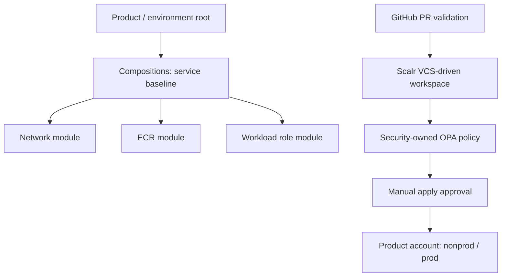

# AWS Terraform/OpenTofu Platform Factory

> **Reference implementation, not production validated.** No real AWS account, Scalr credentials, Terraform state, remote plan or deployment were used.

Versioned modules + compositions + consumer roots; governance via GitHub validation and **Scalr VCS-driven remote plan/apply**. Platform-owned invariants, consumer-tunable validated inputs, and separately approved exceptions.

## Design



## Account strategy

Management; Security OU (Audit, Log Archive); Infrastructure OU (Platform, Shared Services); Workload OU (per-product prod/nonprod); Sandbox OU. Organizational and environment separation coexist. Management account should not run application workloads.

## Contents

- `modules/ecr`: constrained ECR module (encryption, immutable tags, scanning)
- `modules/network`: VPC/subnet baseline (illustrative topology)
- `compositions/container-foundation`: nested module composition
- `live/product-a/nonprod`: sample root using composition
- `policies/terraform.rego`: plan policy sample
- `.github/workflows/validate.yml`: offline-safe Terraform fmt/validate and static checks (pin all actions for production)
- `scalr/README.md`: VCS-driven remote execution, approvals and governance checklist
- `docs/`: architecture decisions, threat model, module versioning, interview notes

## Usage

```bash
terraform fmt -check -recursive
# Each module/consumer must be initialized separately:
terraform -chdir=modules/ecr init -backend=false
terraform -chdir=modules/ecr validate
python3 -m unittest discover -s tests -v
# Optional: opa test policies -v
```

**Do not run `apply` against an actual AWS account without reviewing the configuration, creating Scalr workspaces, configuring remote state and policy enforcement, and validating IAM/SCP boundaries.**

## Hardcoding vs flexibility

Mandatory: immutable ECR tags, encryption, registry scanning, no broad wildcard deployment roles. Configurable with validation: repository names, lifecycle retention, CIDR, environment, tags. Changes to platform invariants require platform-owned module version changes, security review, and controlled rollout. Policy must also inspect the complete plan to detect direct raw resources that bypass modules.

## Release strategy

Modules should be published to a private versioned registry or Git immutable tags; consumers pin exact versions. Example uses local relative module paths for offline demonstration only. Use semantic versioning, changelog, compatibility tests and staged rollout.
